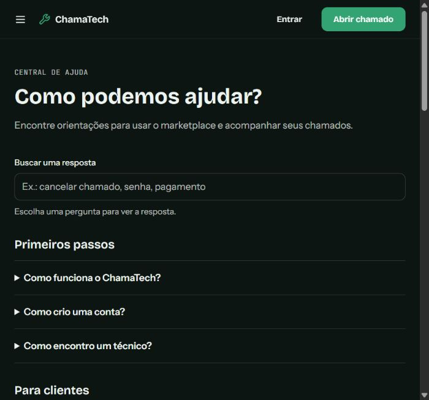

# ChamaTech

Marketplace em desenvolvimento que conecta clientes a profissionais de TI. Clientes solicitam e acompanham atendimentos; técnicos verificados recebem solicitações e atualizam cada etapa; administradores analisam cadastros, disputas e denúncias.

## Estado atual

O fluxo principal está implementado: cadastro com verificação de e-mail, busca, chamado, aceite, acompanhamento, conclusão e avaliação. Também há dashboards por perfil, central de ajuda, mensagens no chamado, notificações, e-mails transacionais opcionais e registro de ações administrativas.

Ainda não está pronto para lançamento público. Consulte [Limitações conhecidas](#limitações-conhecidas) e configure os serviços externos antes de disponibilizar a aplicação.

## Funcionalidades

- **Clientes:** busca por proximidade aproximada e especialidade; chamado ativo com linha do tempo; filtro por status; cancelamento; avaliação vinculada ao atendimento; disputa; notificações e mensagens.
- **Técnicos:** cadastro sujeito à verificação; disponibilidade; fila de solicitações; atualização de status; métricas do mês; respostas a avaliações; mensagens no chamado.
- **Administradores:** verificação de técnicos, usuários, disputas, moderação de avaliações sem apagar registros, contadores, filas e atividade auditada.
- **Público:** landing page, termos e privacidade em modelo para revisão jurídica e central de ajuda com busca.
- **Segurança:** permissões verificadas no servidor, Zod nos inputs, e-mail verificado para abrir ou aceitar chamados, limites de chamadas e dados de endereço fora da busca pública.

## Capturas de tela

Página inicial em viewport mobile:


Central de ajuda em viewport mobile:



As telas autenticadas ainda precisam de capturas com dados de demonstração antes da divulgação pública.

## Stack

- Next.js 15 App Router e React 19
- Tailwind CSS v4
- Better Auth
- PostgreSQL com `pg`
- Zod
- ESLint e Vitest

## Rodar localmente

Requisitos: Node.js 20 ou superior e PostgreSQL.

```bash
npm ci
```

Copie `.env.example` para `.env.local` e preencha pelo menos `DATABASE_URL`, `BETTER_AUTH_SECRET`, `BETTER_AUTH_URL` e `NEXT_PUBLIC_APP_URL`. Configure o envio de e-mail para testar verificação de conta e notificações transacionais.

```bash
npm run db:generate-auth
npm run db:apply-schema
npm run dev
```

Para uma instalação já criada com o schema anterior do ChamaTech, você também pode revisar e executar [`db/migrations/2026-10-14-chamatech-features.sql`](db/migrations/2026-10-14-chamatech-features.sql) no PostgreSQL. A migração é transacional e pode ser reexecutada; ela pressupõe que as tabelas base `"user"`, `reviews` e `notifications` já existam.

Abra `http://localhost:3000`. O primeiro administrador deve ser criado usando `npm run db:promote-admin` e as variáveis descritas em [docs/seguranca.md](docs/seguranca.md). Nunca coloque segredos em variáveis `NEXT_PUBLIC_*`.

## Variáveis de ambiente

| Variável | Uso |
| --- | --- |
| `DATABASE_URL` | Conexão PostgreSQL |
| `BETTER_AUTH_SECRET` | Segredo de sessão do Better Auth |
| `BETTER_AUTH_URL` | URL base do Better Auth |
| `NEXT_PUBLIC_APP_URL` | URL pública usada nos links de e-mail |
| `RESEND_API_KEY` | Envio de e-mail pelo Resend |
| `EMAIL_FROM` | Remetente verificado no Resend |
| `SUPPORT_EMAIL` | Contato mostrado na central de ajuda |

As demais integrações listadas no `.env.example` estão fora do escopo atual e não são usadas pelo fluxo principal.

## Comandos

```bash
npm run lint
npm run test
npm run build
```

O GitHub Actions executa os três comandos em cada push e pull request.

## Estrutura

- `app/`: páginas, layouts, server actions e endpoints
- `components/`: navegação, formulários e componentes de interface
- `lib/services.js`: regras de transição, permissões e operações do chamado
- `lib/faq.js`: conteúdo editável da central de ajuda
- `db/schema.sql`: schema e alterações compatíveis com reexecução
- `scripts/`: configuração do banco e criação inicial de administrador

## Limitações conhecidas

- Pagamentos, upload de mídia, rastreamento ao vivo e chatbot não estão implementados.
- O chat atualiza por polling leve, sem websockets.
- O rate limit restante usa memória do processo. Para várias instâncias, configure um armazenamento compartilhado como Redis.
- E-mails dependem de uma conta Resend e domínio remetente configurado; falhas de envio são registradas no servidor e não desfazem o chamado.
- A verificação de técnico é uma revisão administrativa de perfil, não uma checagem documental ou de antecedentes.
- Exclusão self-service de conta ainda não existe; pedidos devem ser enviados ao suporte.
- Os textos de termos e privacidade são modelos e precisam de revisão jurídica antes do lançamento.
- A aprovação de um técnico e a primeira promoção de administrador exigem configuração operacional explícita.
- As consultas de localização calculam distância aproximada para a busca; a cobertura depende dos dados informados no perfil.
- `npm audit` ainda aponta cinco alertas de alta severidade na dependência de desenvolvimento transitiva `braces`, puxada pela configuração do ESLint. `npm audit --omit=dev` retorna zero vulnerabilidades; reavalie esse alerta ao atualizar a cadeia de lint.
